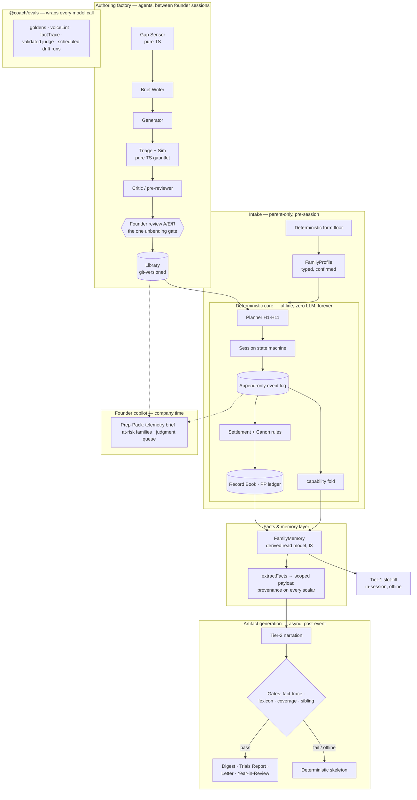

# The AI System Vision — Family Co-Training Coach

_Fable-tier synthesis, 2026-07-18 night session. Inputs: lenses 1-6, both idea sets, `research/llm-architecture-patterns.md`, the Codex cross-model proposal (`codex-independent-proposal.md`, landed mid-synthesis and integrated throughout — its keeps are marked "Codex #n"), and the governing docs (PLAN.md, CONTEXT.md, coach-voice, library-authoring-pipeline, adaptive-engine). This document proposes; the founder decides. Terms per CONTEXT.md._

---

## 1. Executive summary

The AI story for this product is not a chat coach. It is the opposite, and that is the point: **a deterministic engine is the only author of facts; the LLM is a stylist that borrows those facts under a mechanical gate and may add zero of its own; and an agent fleet staffs the company — authoring content, running evals, and briefing the founder — so one person operates like a staffed studio.** By 2026 a conversational fitness bot is a weekend of API glue. Far rarer — and this is a positioning hypothesis to confirm in the recon PLAN schedules, not an established fact — is a coach whose every scalar is provenance-linked so it cannot state a fact it wasn't given, works in an offline basement, and gets warmer the longer the family trains — because warmth here is *memory*, and memory is a fold over an append-only log, not an LLM's recollection.

This is simultaneously a strong consulting showcase Michael can build: the scaffolding — pipelines, evals, provenance contracts, minor-surface policy automation — is the durable engineering enterprise clients pay for (a consulting-value hypothesis until backed by qualified leads or paid work), and none of it is fakeable in a demo.

**The five moves that matter most:**

1. **Name the memory seam now.** Fold `FamilyMemory` + provenance-typed facts into the engine build already on the critical path — hours of re-org, not new scope. Every later AI surface becomes cheap and safe because of it.
2. **Ship the artifact spine.** One `Artifact` contract; Weekly Pact digest and Trials Report first (Phase 1), the annual Sealed Letter as the emotional flagship, Year-in-Review as the Phase 2 virality engine.
3. **Run the library pipeline as a standing agent factory,** gated by an `@coach/evals` package — and write the client-facing case study as it's built.
4. **One weekly founder artifact:** the Prep-Pack (telemetry brief merged in), so 8-10 hours land only on judgment.
5. **Climb the runtime ladder in public, evidence-first:** constraint chips (P1, deterministic, no amendment) → confirmed natural-language parse (**candidate amendment** — it is an LLM call between the family and tonight's Session, which PLAN bans outright, so it needs explicit founder ratification against that exact sentence, not a nod) → **shadow-mode LLM planner** (**candidate amendment** — an LLM generating Sessions at runtime is out-of-scope through Phase 2 by PLAN's letter; Phase 2 builds only the fence-clean scaffolding, the shadow *run* itself is Phase 3-gated) → proof-carrying LLM-proposes/planner-verifies (P3, promoted only on accumulated evidence). The deterministic core is what makes each rung shippable.

Cross-model corroboration: Codex, working independently from the same docs, opened with *"The hard fence is correct... executable policy remains the authority"* and converged on the same architecture. Two models reading the same governing docs landed on one design — a corroborating design-review result (correlated reviewers, not independent market evidence): it raises confidence in the architecture candidate, and validates neither product demand, consulting demand, nor differentiation, which stay on the numeric gates.

---

## 2. The thesis: the one-way ledger

The candidate line — *"the engine decides, the AI narrates, the agents staff the company"* — is right about who does what and silent about why it's defensible. The improvement is the invariant underneath:

> **Facts flow one way.** The engine writes the record; the record feeds the voice; the voice never writes back. Every crossing between the deterministic world and the generative world is a gate: founder review going *into* the library, mechanical fact-traceability coming *out of* narration. There is no path — none — by which a model's output becomes a fact in the family's record.

Call it the **one-way ledger architecture**. Three roles hang off it:

- **The engine authors facts.** Planner, adaptive engine, settlement, Canon rules — deterministic, unit-testable, offline. The coach's authority is "the program and the family's own record" (coach-voice §1); the one-way ledger is that sentence as an architecture.
- **The model borrows facts.** At authoring time it drafts *candidates* the founder approves; at narration time it styles a *frozen, scoped facts payload* and every number in its output must exist in the input (coach-voice §6, adaptive-engine §6 — already unified in spirit; §3 below unifies them in code).
- **The agents staff the company.** Generation, triage, critique, telemetry briefs, support triage — all between founder sessions, all draft-never-decide, all landing in one review queue.

**Why this beats a chat coach — commercially, not just morally.** First, chat is commodity: by mid-2026 a conversational fitness bot is a weekend of API glue, and clients who have shipped LLM features know it — "the scaffolding around the model is the durable engineering; the model call is the commodity" (research doc, framing note). Second, chat with minors is a liability surface, not a feature: the 2025 COPPA amendments are in force as of April 2026, over a quarter of tested child-marketed AI responses were found developmentally inappropriate, and the emerging design consensus for children is *bounded, non-personified, broadcast interaction* (research §d). This product had broadcast-not-chat as a **design conviction before it was a compliance strategy** — that ordering is the story. Third, the deterministic core is not the ceiling on ambition; it is the enabler of it: H1-H11 plus the band contract are a complete, tested **verifier**, and owning a verifier is what makes Phase 3 runtime generation shippable where competitors will be stuck trusting a generator (lens 6's "we already built the verifier" — the single best strategic observation of the night).

And there is a second product hiding in the first: **the company itself.** A solo founder at 8-10 hrs/week operating a content factory, an eval stack, and an ops copilot — with charts (keep-rate, Critic accuracy, band-hit rate) instead of vibes — is the case study Michael's consulting clients actually want to buy. The product proves the practice.

**Two honest critiques to carry (Codex, seconded).** First: as currently designed, "AI-native" overstates what a family *experiences* in v1 — a deterministic engine with mail-merged coaching text is architecturally right but perceptually indistinguishable from a clever generator. The answer is never to weaken the fence; it is to **make the intelligence legible** — the decision ledger and Why-Tonight card (§4), visible evidence that tonight's plan emerged from *this family's* history. This lands directly on the A/B framing test PLAN already schedules ("adaptive coach" vs "AI coach") — market the v1 layer as the safety-first heuristic kernel it is, and *earn* the "learned personalization" claim in Phase 2. Second: the adaptive engine's ⚙ coefficients are one family's lived heuristics, not empirical intelligence — `calibrating|established|stale` is operational state, not statistical uncertainty. Fine for v1; but Phase 2's learning must ship with real uncertainty (posterior confidence, calibration plots, minimum sample sizes) or sparse logs will produce authoritative-looking decisions from weak evidence.

---

## 3. System architecture

Seven layers. The in-flight Session (the Session execution loop) touches only the deterministic three (engine, memory-slice, Tier-1 slot-fill) — no network, no model, ever.

**Layer roles and their reusable showcase patterns:**

| Layer | Job | Reusable client pattern |
|---|---|---|
| Authoring factory | LLM drafts candidates; triage kills garbage; founder gates everything | **Human-in-the-loop content factory with measured quality gates** |
| Deterministic engine | Authors every fact; verifies every session | **Deterministic verifier envelope** (the Phase 3 unlock) |
| Facts & memory | One derived read model; provenance is a type; AI surfaces are projections | **Fact-traceable personalization over event-sourced logs** |
| Artifact generation | Prose over frozen facts, mechanically gated, deterministic fallback | **Zero-added-facts narration contract** |
| Intake | Conversation (later) over a form floor → one typed, confirmed object | **NL-to-structured-object with human confirmation as the consent gate** |
| Founder copilot | Reads telemetry + repo, drafts, never decides | **Agent-ops for a one-person company** |
| Evals | Gates every model/prompt/library change; scheduled drift runs | **Eval-as-code with a validated judge** |

Three structural decisions worth stating as law:

1. **`FamilyMemory` is the only door.** No AI surface reads the event log or settlements directly; everything consumes `scopeMemory(memory, lens)` projections (lens 2, M1/M6). This makes "clipboard, not camera" structural — the banned "I saw your form slipping" is unreachable because no `MemoryFact` exists for it — and it makes the teen companion (Phase 2) a scope function, not a fork. The Reason-record contract (adaptive-engine §6) and the Tier-2 payload contract (coach-voice §6) unify into one `MemoryFact` type with an evidence ref that must compile.
2. **Never summarize on a timer.** Deterministic aggregation runs at every settlement; LLM narration runs only at Tier-2 events over frozen payloads. There is no rolling job that asks a model to re-summarize the log into memory — that is the drift trap where memory becomes confabulation (lens 2 M5, corroborated by research §b: summarize-on-write is lossy and irreversible; event-sourced-with-rebuildable-derivations is the 2026 best practice, and it makes COPPA erasure *provable* — redact events, re-fold, done).
3. **One policy kernel validates everything** (Codex #2). H1-H11, voice prohibitions, COPPA content rules, and library acceptance rules live as versioned, typed policy — TypeScript config + schemas + validators + rejection codes + generated property tests, not a DSL. The *same* policies validate authored content, planned sessions, generated artifacts, and (later) shadow/runtime LLM proposals; and a youth-S&C reviewer signs a human-readable policy export in which every approved rule maps to an executable test. This is `@coach/evals` and the constraint layer unified into one artifact instead of two parallel truths.

---

## 4. The feature portfolio, phased

Selection principle: every kept feature either (a) deepens the one-way ledger, (b) converts the record into a felt family moment, or (c) staffs the company. Features that merely decorate got killed.

### Killed, by name

| Killed | One line why |
|---|---|
| **Season narrative** (lens 1 #7) + **Season Saga** (wildcard #5) | A third retrospective between the monthly Trials Report and the annual Sealed Letter dilutes all three; folded into the Letter. |
| **Playground Scout** (wildcard #10) | CV-fence creep in spirit, and the pipeline is demand-driven by design — the founder's 16 months of lived data beats a parking-lot photo. |
| **Synthetic Rival** (wildcard #11) | A fake opponent violates the Fabricator rule and the measured-against-your-own-past thesis; Cousin Trials (real families) is the honest version. |
| **Trading cards** (wildcard #12) | The art is a minor-likeness risk, the stats duplicate the Record Book, and the whole shape edges toward the banned XP-dispenser. Killed entirely. |
| **Belt Ceremony scripts** (wildcard #7) | One line from the Entertainer anti-pattern and the 14-year-old's flat stare; the canon skill-unlock line already owns this moment. |
| **Ghost of Last Tuesday** (wildcard #8) | Honest per its own author: not an AI feature, and it overlaps backlog Ghost Bar. Returned to the product backlog. (Per-rep timestamps are *not* pulled into the Phase 0 log on speculation — the event contract carries only fields a Phase 0 behavior demonstrably needs; a timestamp field is added if and when the Ghost Bar earns a phase slot.) |
| **Conversational intake layer** (lens 4 P2 top half) | Demoted, not killed: the deterministic form floor ships; conversation earns its way in only if completion telemetry shows drop-off. Ten beta parents are motivated by definition. |
| **Standalone Weekly Founder Brief** (lens 5 #1) | Merged into the Prep-Pack per its own open question 1 — one weekly artifact, not two. |
| **Audio splice library** (lens 1 #9 option a) | Robotic seams risk the premium voice; whole-file pre-render of slot-free lines (option b) ships, splicing waits for the family to ask for spoken numbers. |
| **The Commissioner** (wildcard #9) | Parked as the Phase 3 north star it is; pulls zero scope forward. |

### v1 / Phase 0 — one authoritative delta over PLAN's locked path

**Read this table against the kill-switch, not around it.** `library-authoring-pipeline.md` §5 pins Phase 0 to "repo files + scripts + PR review (build ~0 new surface)" and says building more before the week-2 paper-session kill-switch clears "would be scope creep"; PLAN Gate 0→1 requires that paper test *before UI investment*. So each row below carries a **gate tag**: **[pre-paper]** = required before the paper-session test (the Planner/data-model slice, the seed Library, and the minimum scripts to generate and inspect paper Sessions); **[post-paper]** = after the paper test passes but before family Session zero; **[post-0→1]** = deferred until Gate 0→1 clears or a manual version measurably eats founder minutes. Nothing here is a new *session* on the critical path; the pre-paper rows are the re-orgs §8 defends, and the later rows are honestly labeled as later.

| Feature | Gate | What | Cost | Showcase | Governing constraint |
|---|---|---|---|---|---|
| **`FamilyMemory` + `MemoryFact`** (lens 2 M1/M2) | **[pre-paper]** | The named derived read model + provenance-typed facts, named as the seam while implementing the engine data model (a re-org of functions the model already specifies, not new scope) | S | **High** | I3 derived-never-stored; recompute must equal cache |
| **Canon rules, core set** (lens 2 M3) | **[pre-paper]** | PB, first-of-category, skill unlock as deterministic `MilestoneRule`s at settlement — the Record Book's Phase 0 thin slice, typed | S-M | Med | I4 append-only; I9 witnessed; never LLM-decided |
| **Typed triage scripts** (lens 3 P5; Codex #2) | **[post-paper]** | `voiceLint` + `factTrace` + `keepRate` written as typed, tested functions (not loose scripts) as the triage engine of authoring session #1 — this is the roadmap's already-required schema/voice/sim triage, written once as reusable exports. **Not** a generalized `@coach/evals` package or a policy-kernel abstraction yet: the package boundary and the "one policy kernel validates everything" ambition (§3.3) are extracted only when a second consumer or a paying client justifies the abstraction | S-M | Med | App-shaped; genericized only when a client pays |
| **Event contract + telemetry** (Codex #3) | **[pre-paper]** | Log schema distinguishes target/achieved/missing/skipped/down-swap/corrected/parent-verified, logger identity, a data-quality weight, swap-away, and time-model residuals — the fields demonstrably required by Phase 0 product behavior and unrecoverable if ambiguous now | S | Med | No analytics on controller surfaces; no open-ended child text |
| **Prep-Pack v1** (lens 5 #6) | **[post-0→1]** | Session-start script: judgment queue, gate status, pending batches, the one hard call | S | High | Drafts, never decides; reads repo + local logs only |

### Phase 1 — the artifact spine + the factory closes its loop

**Scope honesty first.** PLAN Phase 1 is a *locked, full* path already: accounts/family model, the COPPA compliance gate, youth-S&C sign-off, Trials, Challenges, onboarding, coach voice v1, both-parent **monthly** recap, beta recruitment, and acquisition tests — against 8–10 protected founder hours/week, with Gate 1→2 measured on retention and payment, not artifact breadth. Everything in the table below beyond **coach voice v1** and the **monthly Trials Report/recap** is *proposed beyond that locked path* and is **gated on Gate 0→1 clearing plus demonstrated manual pain** — not assumed into Phase 1. It is sequenced here for design coherence, not scheduled. Phase 0 types are designed to *permit* these consumers cheaply (§8), never to *require* them.

| Feature | What | Cost | Showcase | Governing constraint |
|---|---|---|---|---|
| **Artifact contract + monthly Pact digest** (lens 1 #3) | One `Artifact` schema; the digest to **both** parents — the bystander-parent fix and the forward-to-a-friend surface. Cadence tracks PLAN's **monthly** recap; a weekly cadence is a candidate addition, not assumed | M | High | Minors as nickname/initials; zero commercial speech; templated version can ship before LLM narration |
| **Trials Report, flagship keepsake** (lens 1 #4) | The §4 golden promoted to a designed print/screen artifact | M | High | F7 golden regeneration first; drought guard in the payload, not the prompt |
| **Then-vs-Now recap** (lens 1 #2) | Per-session close, one beat per member vs. own history | M | High | Skeleton must handle a no-PB night with grace |
| **Sealed Letter** (wildcard #1, absorbs #5) | Annual per-member letter from the year that actually happened; sealed, opened next season | S | **High** | The emotional bar is brutal — founder taste-pass mandatory, never ship-and-forget |
| **Skill graduation certificate** (lens 1 #5) | Keepsake print; standard text is Tier-1a verbatim, LLM narrates only the surrounding story | M | Med-high | I1 immutable standards; hard template/narration separation |
| **Decision ledger + Why-Tonight card** (wildcard #4, deepened by Codex #1) | Expand the Reason record into a full per-session decision ledger (candidates considered, rejection codes, soft scores, versions, seed); render 2-3 lines to the family, keep the engineer-facing trace | M | **Very high** | Three family-facing sentences max or it's the Academic; the ledger is the "make the intelligence legible" answer to the AI-native perception gap |
| **Trials Scouting Report** (wildcard #6) | Pre-Trials one-liner: the test nearest a tier crossing | S | Med | Under-11 private by default; never implies a line *should* have fallen |
| **Torch Pass Prophecy** (wildcard #2) | Projected date a kid crosses a parent's all-time best, hedged, in the Record Book | M | High | Parent-only until the actual pass; wide honest bands; never a countdown at an under-11 |
| **Agent factory, full roster** (lens 3 P1/P2/P4; Codex #5/#6) | Actions crons + Convex gap sensor + Critic predicting founder verdicts — plus prompt-isolated metadata/safety/voice critique passes whose *disagreements* surface on the review card, and evidence-typed metadata (taste fields cite goldens, safety fields cite curated youth-S&C guidance or get rejected) | **L** (crons, a learned Critic, isolated critique passes, evidence citations, review-card integration — split into tracer-bullet deliverables, default to manual scripts until measured founder time justifies each) | **High** | Breaks the self-labeling circularity Codex flagged (generator and evaluator sharing one mistaken representation); founder A/E/R remains the sole minting gate; `library-authoring-pipeline.md` §5 allows only one thin review route in Phase 1 |
| **Coverage cartography** (Codex #4) | The sim harness as a coverage-space explorer: viable-candidate counts and constraint-failure heatmaps across roster/age/budget states; authoring queue requests the item with greatest coverage gain per founder review minute | **L** (state-space simulation, heatmaps, an optimization loop — `library-authoring-pipeline.md` §5 defers gap dashboards/analytics to "Phase 2+ only if beta demand forces it") | **High** | The gap sensor, upgraded from "pool is thin" to "where the planner barely survives" — and the most demoable ops visualization in the system |
| **Founder copilot cohort tools** (lens 5 #2/#3/#5) | **Three separate products**, not one row: retention early-warning (≤3 families/week), support triage (classify-only first), phase-boundary competitor recon | **L** (each a standalone M workstream with its own spec, failure UX, and founder acceptance) | High | Interventions drafted for parent surfaces only; recon claims REPORTED until verified; default to manual reports until measured founder time justifies automation |
| **Intake: form + `FamilyProfile` + confirmation cards** (lens 4 P1/P3/P4/P5) | Typed profile; confirmation cards are **one UX step of the COPPA consent flow, not the gate** (PLAN Phase 1's gate is the full data map + vendor DPAs + analytics policy + parental review/delete flows + counsel/safe-harbor review — a card cannot double as that); clamped priors (±1 grade, W ∈ [0.7×, 1.3×]) | M | High | **No temperament or interview-derived attribute attaches to an under-13 sub-profile** (nickname + birth year only — CLAUDE.md hard rule, CONTEXT.md sub-profile); any structural tuning flag lives at family/parent level or as a Session input only where the data map permits; transcript discarded; log outranks interview by construction |
| **Constraint chips** (lens 6 amendment, part 1) | "Go easy on: [legs] [pushing] [everything]" → typed deltas into the unchanged planner | S | Med | Zero LLM; obviously fence-clean; the parser's deterministic floor |
| **Evals: `runGoldens` + `regress` + drift runs** | Versioned golden regression; nightly scheduled run against the pinned model | M | High | Research §c: the scheduled live-endpoint run is the check almost nobody does |

**One Phase 1 architecture ruling — claim-graphs, hybrid (Codex #7 vs. lens 1).** Codex proposes replacing "generate prose, then lint" with a typed claim inventory: the engine emits permitted claims (`PB_DELTA`, `PACT_COMPLETE`, …) with evidence IDs and allowed comparison scopes; the LLM selects and orders claim IDs; a deterministic renderer inserts numbers. This makes forbidden comparisons *structurally unavailable* rather than lint-caught — strictly stronger. My ruling: **adopt claims as the payload's typed layer everywhere** (the `sanctioned_comparison` flag becomes an allowed-treatment on a claim, which is cleaner), and use the **deterministic-renderer mode for short artifacts** (digest, recap, scouting report) where structure dominates — but keep **narrate-then-gate for the long-form keepsakes** (Trials Report, Sealed Letter), where prose quality is the product and the mechanical gate already backstops it. Claim-ordering-only generation would flatten the Letter into a listicle; the Letter is allowed to be prose because it is also allowed to fail to a skeleton.

### Phase 2 — reach and the first runtime surfaces

| Feature | What | Cost | Showcase | Governing constraint |
|---|---|---|---|---|
| **Year-in-Review** (lens 1 #8) | The Wrapped moment: interactive + print + share — the Gate-adjacent recruitment asset | L | **High** | Every figure traces to the ledger; minors as nickname/initials; anniversary-timed |
| **Record Book chapters / torch-pass cards** (lens 1 #6) | Prose for chalked milestones + share card | M | Med | `sanctioned_comparison: dad_torch` payload flag so lint allows the one legal comparison |
| **Teen companion AI surface** (lens 6 P6) | Moments-not-chat verbatim on the teen's device; every line parent-visible | M | **High** | Gated on the coach-voice §5.6 review; "age-appropriate AI for a minor, no chat" is a category almost nobody gets right |
| **NL request parser** (lens 6 amendment, part 2) | LLM parses "Ryan has a game tomorrow" → typed deltas, confirmed back to the parent, chips as offline fallback | **L** (a runtime model surface: schema-constrained parsing, confirmation UX, the offline chip floor, evals, telemetry, and a new safety boundary — the "S" it once carried counted only the prompt) | **High** | **Candidate amendment — see §7.** PLAN bans "no LLM call between the family and tonight's workout" *outright*; this touches that letter, not just "the workout loop." Planner stays authoritative |
| **The Archivist** (wildcard #3) | Parent-only Q&A over the family's own record, answers cite sessions | **L** (authenticated RAG, citation guarantees, prompt-injection/jailbreak defenses, COPPA/security review, deletion semantics) | **High** | **Candidate amendment — see §7. Phase 3-earliest unless a governing-doc amendment lands first:** it is the product's first free-text LLM surface and `coach-voice.md` §5.2 says "V1 coach is broadcast-only — there is no chat surface" (§6 pins conversational surfaces to "no earlier than Phase 3"). A parent-only routing rule is an *amendment* to that line, not compliance with it; read-only, never reachable from a controller |
| **Challenge/Trials commentary** (lens 6 P5) | Tier-2 extension: richer arc-aware narration, new fixtures | S | Med | Pure extension of existing gates |
| **Weight-nudge personalization** (lens 6 P4) | LLM tunes the planner's soft-objective weights per family, bounded vector | M | Med | **Fence contact (§7, and fence check below):** LLM-tuned weights make model output participate in session generation — which valid blocks the Planner selects — even with H1-H11 intact. Through Phase 2, prefer the deterministic **constrained learned ranker** (below) or founder-reviewed versioned parameter snapshots; LLM-*tuned* weights move to the Phase 3 runtime-LLM decision |
| **Shadow LLM planner** (Codex #13) | Phase 2 builds only the **fence-clean scaffolding** — replay corpus, proof-record schema, deterministic baselines, scoring harness — with **no LLM planner running**. The shadow *run* itself (structured state + approved IDs in, declarative plan out, scored, never shown to a family) is a **candidate amendment gated to Phase 3** | M (scaffolding); the run is Phase 3 | **High** | A running LLM that generates Sessions in shadow *is* runtime LLM session generation, which PLAN lists **out-of-scope through Phase 2** and as an explicit Phase 3 upgrade — "never shown to a family" honors the fence's purpose but not its letter, so it is not "fence-clean." Founder amendment required before any shadow run; accumulates the evidence that gates Phase 3 |
| **COPPA-compatible learning architecture** (Codex #9) | Training exports split from operational data before any Phase 2 learning: pseudonymous family IDs, coarse time, no nicknames/free text; lineage so parent deletion removes derived training rows; internal dataset cards | M | High | Required before any learned parameter ships; extends the erasure story from operational to training data |
| **Hierarchical Bayesian calibration** (Codex #10; adaptive-engine §5's empirical-Bayes note, upgraded) | Replace hand-tuned ⚙ segments with an interpretable hierarchical model producing *posterior uncertainty*; compiled into versioned deterministic parameter snapshots, so runtime stays offline and replayable | L | Very high | Calibration plots, holdout, subgroup error analysis, minimum sample sizes before any update ships — the answer to the false-precision critique |
| **Constrained learned ranker** (Codex #11) | Offline ranker orders *already-valid* candidates on a **declared multi-objective** (band hit, completion, swaps, voluntary return, roster coverage, workload equity — never raw engagement or streak preservation); signed versioned snapshot, deterministic fallback | L | **High** | The answer to the band-hit-is-too-narrow critique; supersedes the weight-nudge if volume supports it |

### Phase 3 — the runtime era, shadow-first, proof-carrying

**LLM-proposes / planner-verifies** (lens 6 P1 and Codex #14, convergent) via **constrained decoding into the planner's schema** (lens 6 P2): the model emits a typed plan over approved library IDs — never free-form workout instructions or safety language; the deterministic kernel recomputes time, targets, gates, and recovery and accepts only if it can attach a **complete proof record**; failure, timeout, or excess uncertainty falls back to the deterministic planner, which remains permanently resident. The in-flight Session (the Session execution loop) stays LLM-free forever (lens 6 P3's when-not-whether rule). **Promotion is gated on shadow-mode evidence and a written safety case, not the calendar** (Codex critique 5 — adopted; this replaces my earlier "P4 → P1" sequencing with shadow → ranker → proof-carrying proposals). Add a founder-taste sample gate for "legal but flat" sessions (lens 6 OQ4 — band-hit alone is not enough). The Commissioner stays the north star, no scope pull.

---

## 5. The showcase chapter

The consulting practice needs *named, chartable* case studies, not "we used AI." Six, each with the client-facing one-liner:

1. **The Content Factory** — *"A human-in-the-loop content factory with measured quality gates: keep-rate bands, a critic that predicts the reviewer's verdict with a published accuracy curve, and a recall ratchet that converges to zero."* (Lens 3. The Critic's prediction-accuracy chart is a candidate centerpiece slide — it shows the loop learning.)
2. **Fact-Traceable Coach Narration** — *"Narrative generation over event-sourced logs where the model may add zero facts: every scalar is provenance-linked, a mechanical validator checks it, and validation failure falls back deterministically."* (Lens 2 M7 + lens 1. Research §b calls this a high-leverage showcase — most teams get memory wrong, and getting it right is visibly systems design, not prompting. Scope honestly: the validator proves *scalar provenance* and catches banned topics, sibling ordering, and coverage gaps — it does not prove that every qualitative statement, causal implication, or selection is true, so this is not a "cannot lie" guarantee.)
3. **Minor-Surface Policy Automation** — *"COPPA-aware engineering for a child-adjacent product: a banned-lexicon linter in CI, non-personified register, broadcast-not-chat by architecture, and erasure designed as event-log redaction and re-fold."* (Research §d flags youth-safety engineering as a scarce, billable skill — treat as a positioning hypothesis. Full COPPA *compliance* is not claimed here: it is contingent on PLAN Phase 1's data map, vendor DPAs, analytics policy, parental review/delete flows, and counsel/safe-harbor review; erasure is a design target until the deletion spec and end-to-end tests land. Publish the case study only after that gate passes.)
4. **Evals as the Gate** — *"An eval-as-code package gating every model, prompt, and content change — with a judge validated to ≥85% human agreement and a scheduled drift run that catches provider updates no commit caused."* (Lens 3 P5 + research §c: "our CI caught a provider model update degrading tone before any user did" is the war story.)
5. **The One-Person Company** — *"A solo founder operating a staffed studio: telemetry writes the weekly PM brief, agents draft everything, one review queue, and the founder's hours land only on judgment."* (Lens 5. The meta-showcase; design the ops logs shareable-by-construction from day one.)
6. **The Verifier Pattern** (Phase 3) — *"Generative proposals inside a deterministic safety envelope: constrained decoding into an approved-ID schema, eleven hard constraints as the acceptance gate, deterministic fallback always resident."* (Lens 6 P1/P2 — generalizes to every regulated-output domain: finance, legal, healthcare.)

**Demo assets to build (all on the synthetic canonical family — Dad 42 / Ryan 14 / Leo 10 / Sam 8 — so the entire showcase is COPPA-clean by construction):** the batch-review sheet with a live keep-rate chart; a Trials Report generation run where an adversarial payload trips the fact-trace gate on screen and falls back to the skeleton; the coverage-cartography heatmap ("where the planner has choices vs. where it barely survives" — Codex called it exceptional, and it is); the evals dashboard with the drift-run history; the Prep-Pack as a real Monday artifact. **Build-in-public arc:** the case-study docs are written *as the systems are built* (lens 3 P6's `docs/case-study/` pattern), one publishable chapter per phase gate — the gates themselves make the narrative honest, because every chapter ends with a number that was either hit or missed.

Mechanics worth noting from the research: Message Batches API halves authoring cost and prompt-caching makes the shared CONTEXT.md-derived prefix nearly free — the factory's unit economics are themselves demo material.

---

## 6. Eval & safety architecture

Consolidated from lenses 2/3 and research §c/§d into one stack, cheapest layer first:

1. **Deterministic assertions (free, never flaky, run on everything):** H1-H11 planner invariants; adaptive-engine property tests (monotonicity, sandbag bound, under-11 never-shrinking visible numbers); `voiceLint` (banned lexicon, fabricated-observation verbs, sibling-ordering with the `sanctioned_comparison` allowance, register mismatch, money words); `factTrace` (every number in output ∈ payload); schema/enum validation on every pipeline stage.
2. **Golden regression:** 30-50 cases, not 500 — runs in minutes or it gets disabled (research §c). Moment-map lines (F7-regenerated first), golden sessions pinned per library version, golden Reason records, adversarial Tier-2 fixtures (a regressed-kid month, a two-member month, a first Trials with no history). **Every founder reject and every line that lands flat in the garage becomes a golden case** — the museum of mistakes never repeated.
   The longitudinal sim harness grows into the **family digital twin lab** (Codex #8): synthetic families with capability growth, noisy kids, roster churn, under-logging, and hostile scenarios (sparse library, one dominant athlete, a perpetually absent member), run in thousands of 8-12-week trajectories against every planner/library/parameter change. "Simulation before children" is both the engineering posture and a headline the showcase can say out loud.
3. **Validated judge:** an LLM judge for tone/faithfulness only after ≥85% agreement with founder labels on the golden set; different model family than the generator; median-of-3 on noisy metrics; binary rubrics, never Likert averaging.
4. **Scheduled drift runs:** nightly against the pinned live endpoint, plus a reference audio render per voice to catch provider voice updates. Failures with no commit are the ones nobody else catches.
5. **The garage:** the founder's family is eval zero, permanently. The 14-year-old's flat stare outranks every checklist.

**The kid-safety eval suite as a differentiator.** This deserves its own named artifact — call it the **minor-surface suite**: the banned-lexicon linter extended with the non-personified-register rules the child-safety literature converged on (no trust cues — "I'm always here," no embodiment, no secrets-keeping, no re-engagement guilt, no streak/FOMO pressure in coach speech); age-register checks (the Sam test: sayable to an adult without embarrassment); the five-phase red-team protocol (baseline, adversarial, safeguarding-stress, mixed-intent, clean-exit) run against every minor-visible surface before each phase gate; and the erasure test (tombstone → re-fold → assert absence in every projection — an engineering control, not a claim of legal compliance). Package it alongside the eval stack. Designed to differentiate: we have not yet found a fitness competitor doing this and few kid-tech products appear to (both REPORTED, pending the recon PLAN schedules at each phase boundary) — and it is simultaneously the product's insurance policy and a candidate calling card for the consulting practice.

---

## 7. Candidate fence amendments — founder decisions

Most of this document fits inside the fences, but not "everything else": **six** proposals touch a fence, not four. The four below are argued both ways with a recommendation; the remaining two — the **LLM weight-nudge** and the **shadow LLM planner** (both make model output participate in runtime session generation, which PLAN keeps out-of-scope through Phase 2) — are surfaced in the Phase 2 table and the fence-compliance check, and each needs the same explicit founder ratification, not a silent pass.

**A1. Natural-language pre-session request parsing (lens 6).** *For:* it runs at request time, before planning, emits only schema-constrained typed deltas, is confirmed back to the parent before it binds ("Easy on legs, protecting tomorrow — right?"), and degrades to chips offline. The planner remains sole author of the session. *Against (stated honestly):* this is not merely "the workout loop." PLAN §"Key decisions" says flatly **"No LLM call between the family and tonight's workout"** and lists "runtime LLM session generation" as out-of-scope through Phase 2 / an explicit Phase 3 upgrade. A parser is literally an LLM call between the family and tonight's Session whose output changes that Session — so the "before planning, not in the timer loop" defense narrows a fence PLAN wrote broadly. A misparse produces a legal-but-wrong Session H1-H11 cannot catch, and it puts a network dependency on the path to tonight's plan. Its true cost is **L**, not S: schema-constrained parsing, confirmation UX, the offline chip floor, evals, telemetry, and a new safety boundary. *Ruling I recommend:* **chips ship in Phase 1 with no amendment needed** (deterministic UI). **The parser is a genuine candidate amendment requiring explicit founder ratification against PLAN's exact "no LLM call between the family and tonight's workout" sentence** — not a pre-approval buried in this vision, and not a Phase 2 default. If ratified, it earns a Phase 2 slot conditional on typed-deltas-only output, mandatory parent confirmation, planner authority untouched, and chips as the permanent offline floor; otherwise it is a Phase 3 item. It is the single most demoable pattern in the portfolio for consulting audiences — worth the amendment, only at the right time and with the fence-holder's eyes open.

**A2. The Archivist (wildcard #3).** *For:* a parent-only, read-only, cite-your-sessions Q&A over the family's own record is the coach's clipboard made queryable, retention gold, and the strongest RAG-with-governance showcase in the set; it is neither the in-flight Session nor minor-facing chat. *Against (stated honestly):* it is the product's first free-text LLM surface — a jailbreak and prompt-injection surface — and it does not merely *respect* the current architecture, it **amends a governing doc**: `coach-voice.md` §5.2 says "V1 coach is broadcast-only — there is no chat surface," and §6 pins conversational surfaces to "no earlier than Phase 3." A parent-only routing rule turns "no chat surface" into "chat exists but is intended for adults" — that is an amendment, not compliance, and the estimate is **L** (authenticated RAG, citation guarantees, injection/jailbreak defenses, COPPA/security review, deletion semantics). *Ruling I recommend:* **defer to Phase 3 by default.** It may earn a Phase 2 slot only if the founder *first* amends `coach-voice.md` §5.2/§6 explicitly and the item then passes its own security/COPPA review with a proven access boundary — parent-authenticated, never reachable from a controller, answers only from `scopeMemory(parent lens)`, every number cited, refusal-tested in the minor-surface suite, with deletion behavior specified. If the boundary can't be made crisp, it waits for Phase 3 without regret.

**A3. Intake `interview_offset` (lens 4 P4).** Barely an amendment — a clamped initialization offset inside the founder-authored priors table, preserving the replayable fold; the log outranks it within three sessions by construction. *Against:* it complicates the cleanest sentence in the engine ("placement by training, not by test"). *Ruling I recommend:* **accept as a Phase 1 spec delta** to adaptive-engine §1.2. Cheap, honest, strictly narrowing.

**A4. Teen companion bounded dialogue (lens 6 frontier map).** *For:* a scoped skill-Q&A over the teen's own record, parent-visible, could be the retention hook for the product's hardest user. *Against:* moments-not-chat is the product's deepest safety conviction and its cleanest differentiator; the pull toward conversational drift is strongest exactly here, and the moderation surface is unstaffable at solo-founder scale. *Ruling I recommend:* **no.** Ratify moments-not-chat as a *permanent* teen-companion constraint at the Phase 2 review. The reopen condition (a passed adversarial-minor eval harness plus the review's explicit ratification) stays written down in the frontier map, but the default is that this fence outlives Phase 3. The Archivist gives the *parent* the query surface; the teen gets moments that respect him.

---

## 8. Build-on-ramp — the seams to name now (and what explicitly waits)

**The critical path is untouchable:** F31/F32 merges → engine data model + repo scaffold → library authoring session #1 → week-2 paper-session kill-switch → walking skeleton / family session zero (docs/00, roadmap "Next 5 working sessions"). The seams below are genuine re-orgs of already-scheduled work — a type named, a script written as a typed export — that add no session to the path; the items that follow the paper test are labeled as such, matching the gate tags in the §4 Phase 0 table. `library-authoring-pipeline.md` §5 is the governing posture: Phase 0 is repo files + scripts + PR review, and anything more before the kill-switch clears is scope creep.

**Before the paper test (pure seams — re-orgs, not additions):**

1. **Fold the memory seam into the engine-data-model implementation.** When the F31/F32-merged data model is coded, name `deriveFamilyMemory` as the single derived read model and wrap emitted scalars as `MemoryFact` with evidence refs — unifying the Reason-record and Tier-2 payload contracts into one type. This is a re-org of functions the model already specifies (lens 2 costed it S), and it's the last cheap moment to do it: after the first three consumers exist, the seam costs a refactor instead of a decision.
2. **Instrument the walking-skeleton log schema now.** Add swap-away, skip, time-model-residual, and logger-identity/data-quality fields to the event log at design time (cheap now, unrecoverable later) — but *only* fields a Phase 0 behavior demonstrably needs. No speculative per-rep-timestamp field (it rides the Ghost Bar's phase slot, not this one).

**After the paper test passes (before or during Phase 1 — not before):**

3. **Write authoring session #1's triage as typed, tested exports.** The roadmap already requires schema lint, voice lint, similarity checks, and simulation smoke for the seed batch. Write `voiceLint`, `factTrace`, `keepRate` as typed functions instead of loose scripts — same code, one decision about where it lives. This is *not* a generalized `@coach/evals` package or the "one policy kernel" abstraction (§3.3) yet: extract those only when a second consumer or a paying client justifies the boundary. The factory's later automation (Actions crons, Critic) then bolts onto a stable gate.
4. **Script Prep-Pack v1 as company-time work, gated post-0→1.** An agent can build the session-start script between founder sessions — reads the repo and local logs, drafts the judgment queue — but it is founder-facing ops tooling, not a paper-test dependency, so it waits until Gate 0→1 clears or manual prep measurably eats founder minutes.

Everything else in §4 waits its phase. In particular, before the paper test the AI surface is exactly what PLAN already says it is — authoring-time batches + the hand-authored voice starter set — plus seams 1–2 above. No artifact generation, no Critic, no intake build, no pre-rendered audio, no Prep-Pack automation until their gate tags in the §4 table are earned.

---

## Fence-compliance check (this document's own proposals)

- **No LLM call between the family and tonight's Session, v1 (PLAN's actual wording, broader than "the workout loop"):** every v1/Phase 0 item is deterministic code, authoring-time work, or ops scripting. The first runtime-LLM surfaces (parser, Archivist) are *candidate amendments* requiring explicit founder ratification against that PLAN sentence, argued in §7 — not defaults, never smuggled. Phase 3 proposals keep every model call at planning time, cached, with the deterministic planner permanently resident. ✅ for v1/Phase 0; ⚠️ the Phase 2 runtime items are fence contacts, below.
- **45-min cap / bodyweight / no gender:** no proposal touches session structure, equipment, duration, or schema; artifacts and memory are read-only projections. ✅
- **COPPA:** broadcast-not-chat preserved and recommended permanent for teens (§7 A4); all emails/notifications parent-addressed; minors render as nickname/initials on any surface leaving the family; the entire showcase runs on the synthetic family; intake discards transcripts and **stores nothing on an under-13 sub-profile beyond nickname + birth year** — no temperament or interview-derived attribute (CLAUDE.md hard rule); erasure is *designed* (tombstone + re-fold), flagged as the one deliberate I4 exception. This is not a claim of COPPA compliance: compliance is contingent on PLAN Phase 1's full gate (data map, vendor DPAs, analytics policy, parental review/delete flows, counsel/safe-harbor review). ✅ *design*; ⚠️ the delete-vs-append-only spec is unwritten and the Archivist (§7 A2) would add a free-text surface that amends coach-voice — both carried as founder questions.
- **Founder reviews every library item:** the Critic ranks and predicts, never accepts; sim-acceptance nominates, never merges; Tier-2 output is gated and taste-sampled, never merged into the library at all. ✅
- **Offline-during-workout:** Tier-1 slot-fill and the memory slice compute on-device; every artifact has a deterministic skeleton; audio is pre-rendered. ✅
- **Out-of-scope fences through Phase 2:** wearables, CV, nutrition, social feeds all held; Playground Scout and Synthetic Rival were killed partly *because* they leaned on fence-adjacent ground. But "runtime LLM session generation" is on PLAN's out-of-scope-through-Phase-2 list, and CLAUDE.md §"Hard rules" says fences hold through Phase 2 — so these are **not low-stakes nods**, they are amendments to a locked fence, and this document surfaces **all** of them rather than letting any disappear: (1–4) the four §7 items; (5) the **LLM weight-nudge**, which lets model output pick among valid blocks; and (6) the **shadow LLM planner** — even unseen, a running LLM that generates Sessions at runtime is exactly what the out-of-scope line names, so Phase 2 builds only its fence-clean scaffolding and the run itself is Phase 3-gated. None of the six is "fence-clean." Each is an explicit founder decision, argued honestly, before it ships. ⚠️→ six founder calls, correctly weighted.

## 9. Open founder questions (consolidated, deduplicated)

1. **A1 ruling:** chips ship Phase 1 (no amendment). The parser is a candidate amendment to PLAN's flat "no LLM call between the family and tonight's workout" — ratify it explicitly against that sentence, or leave it a Phase 3 item? *Rec: do not pre-approve here; ratify (or decline) as a named amendment, conditions binding if ratified. It is L-cost, not S.*
2. **A2 ruling:** the Archivist is a free-text LLM surface that amends `coach-voice.md` §5.2's "no chat surface." In-appetite to amend that doc for a Phase 2 parent-only surface, or defer to Phase 3? *Rec: defer to Phase 3 by default; Phase 2 only if the doc is amended first and a crisp access boundary is proven.*
3. **COPPA delete vs. I4:** hard tombstone-and-re-fold (clean delete right, needs a re-fold spec) or hide-but-retain? *Rec: hard tombstone; write the spec in Phase 1's COPPA gate.*
4. **Artifact-spine confirmations:** (a) Pact digest to both parents, default-on, one-tap unsubscribe; (b) retrospectives capped at monthly Trials Report + annual Sealed Letter, nothing between; (c) Torch Prophecy parent-only until the actual pass. *Rec: yes to all three.*
5. **Critic verdict visibility:** predicted verdicts visible during review, or hidden until after you decide (anti-rubber-stamping)? Taste call only you can make.
6. **Showcase carve-out:** design ops logs and case-study docs shareable-by-construction from day one (synthetic family only)? *Rec: yes — deciding later means redacting forever.*
7. **Teen dialogue permanence (A4):** ratify moments-not-chat as a permanent teen-companion constraint at the Phase 2 review? *Rec: yes.*
8. **N-of-family experimentation (Codex #12):** in Phase 2, is deliberately varying safe equivalents (75s vs 60s rest, block order) on real families — parent opt-in, stop conditions, sacred benchmarks excluded — in-appetite at all, or does "the coach experiments on us" break trust regardless of safeguards? Genuinely novel, genuinely uncomfortable; your family's read matters more than the stats argument. *Rec: pilot on the founder's own family first or not at all.*
9. **v1 marketing honesty (Codex critique 1):** lean the Phase 1 A/B toward "adaptive coach" and save "AI" language for surfaces where the intelligence is legible (the Why-Tonight card, the artifacts)? *Rec: yes — under-claim and let the decision ledger over-deliver.*
10. **Review-budget honesty:** the Phase 1 portfolio (artifact spine + factory + copilot + intake) assumes the 60-120 min/week review budget holds alongside family testing. If it's really 60, which Phase 1 column do you cut first? *Rec: cut Torch Prophecy and Scouting Report before anything in the artifact spine; the digest and Trials Report are load-bearing.*

---

## Review response log

Codex adversarial review, round 1 (`reviews/codex-review-round-1.md`), verdict REVISE. All findings independently checked against PLAN.md, CONTEXT.md, coach-voice.md, library-authoring-pipeline.md, and CLAUDE.md before action. **14 findings accepted-and-fixed, 0 rejected** (two accepted with an editorial variation on the suggested fix, noted below).

1. **Critical — NL parser is a runtime-LLM fence violation, mislabeled S.** *Accepted-and-fixed.* Re-cost to L in §4 and §7; corrected the fence framing to PLAN's exact "No LLM call between the family and tonight's workout"; downgraded from a buried pre-approval to a candidate amendment needing explicit ratification (§1 move 5, §7 A1, §9 Q1, fence check). *Editorial variation:* kept it retrievable as a Phase-2-if-ratified item rather than hard-moving to Phase 3 — the doc's amendment framing permits a founder to ratify it — but removed every "already approved / narrow / small" implication the finding objected to.
2. **Critical — shadow LLM planner is runtime session generation, self-contradiction on "fence-clean."** *Accepted-and-fixed.* Removed "fence-clean" everywhere (§1, §4, fence check); split the item so Phase 2 builds only fence-clean scaffolding (corpus, proof-record schema, baselines, scoring harness) and the shadow *run* is Phase 3-gated behind an amendment.
3. **High — LLM weight-nudge participates in session generation, unacknowledged in self-audit.** *Accepted-and-fixed.* Flagged as a fence contact in §4 and §7; corrected §7's "four items" to six; steered through-Phase-2 selection to the deterministic ranker / founder-reviewed snapshots. (Kept the statistical Bayesian/ranker items in Phase 2 — they are runtime-deterministic, which the finding also allows.)
4. **High — Archivist blurs the "no chat surface" COPPA boundary.** *Accepted-and-fixed.* Recast as an amendment to `coach-voice.md` §5.2/§6, re-cost to L, defaulted to Phase 3 unless the doc is amended first and a crisp boundary proven (§4, §7 A2, §9 Q2).
5. **High — intake temperament flag on under-13 + "doubles as consent gate."** *Accepted-and-fixed.* Barred any temperament/interview-derived attribute on an under-13 sub-profile; recast confirmation cards as one UX step of the compliance program, not the gate (§4 intake row, fence check).
6. **High — Phase 0 scope creep (generic package, audio, Prep-Pack, rep-timestamps, case-study).** *Accepted-and-fixed.* Cut pre-rendered audio and the generalized `@coach/evals`/policy-kernel from Phase 0; deferred Prep-Pack and rep-timestamps; gate-tagged every remaining row against the paper-session kill-switch (§4, §8).
7. **High — Phase 0 table vs. §8 inconsistency.** *Accepted-and-fixed.* Replaced both with one authoritative gate-tagged delta list ([pre-paper]/[post-paper]/[post-0→1]) and reconciled §8 to it.
8. **High — speculative Phase 1 portfolio justifying Phase 0 abstraction.** *Accepted-and-fixed.* Added a "scope honesty" preamble marking everything beyond coach-voice-v1 + monthly Trials Report as gated on Gate 0→1 / demonstrated pain; corrected the digest cadence from weekly to PLAN's monthly.
9. **High — non-credible effort labels.** *Accepted-and-fixed.* Re-cost NL parser, Archivist to L; agent factory, coverage cartography to L; split founder-copilot into three L-workstreams; cited `library-authoring-pipeline.md` §5.
10. **Medium — "cannot lie" overclaim.** *Accepted-and-fixed.* Renamed the showcase to "Fact-Traceable Coach Narration" and scoped the guarantee to scalar provenance + deterministic fallback (§1, §5).
11. **High — "COPPA 2025 as code" / "provable erasure" overclaim.** *Accepted-and-fixed.* Renamed to "Minor-Surface Policy Automation," erasure recast as a design target, compliance made contingent on PLAN's Phase 1 gate (§5, §6, fence check).
12. **Medium — unverified market-wide claims stated as fact.** *Accepted-and-fixed.* Bounded "almost nobody / no competitor / best slide / rarest and most billable" to hypotheses pending the scheduled recon (§1, §5, §6).
13. **Medium — "two models = evidence" / "exactly what enterprise clients pay for."** *Accepted-and-fixed.* Recast model convergence as a corroborating design-review result (correlated reviewers) and consulting value as a hypothesis (§1).
14. **Low — non-canonical "workout loop" / "record" enabling fence-narrowing.** *Accepted-and-fixed.* Replaced spec uses of "workout loop" with "in-flight Session / Session execution loop" and "a parent's record" with "all-time best" (§3, §4, §7); the fence is now stated once in PLAN's canonical wording and applied consistently.
